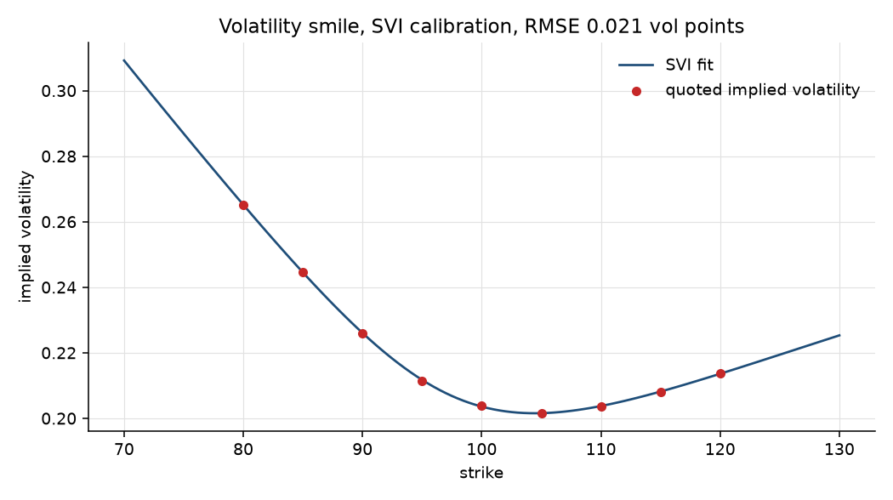

# options-pricer

[](https://github.com/IkerAbad/options-pricer/actions/workflows/ci.yml)
[](LICENSE)

European option pricing in Python: closed-form Black-Scholes, Monte Carlo with
antithetic variates, implied volatility by root finding and SVI volatility
calibration. Every number in this README comes from a command you can run.




## Results

Reference case: spot 100, strike 100, rate 5%, volatility 20%, expiry 1 year.

| Quantity | Value |
| --- | --- |
| Black-Scholes call | 10.450584 |
| Delta | 0.636831 |
| Gamma | 0.018762 |
| Vega | 37.524035 |
| Theta | -6.414028 |
| Rho | 53.232482 |
| Monte Carlo, 1,000,000 paths | 10.456536 |
| Standard error | 0.014737 |
| 95% interval | [10.427652, 10.485419] |

The analytic price falls inside the Monte Carlo interval. The standard error
falls with the square root of the number of paths, which is what the first plot
shows.

SVI calibration on a synthetic smile with 0.1 % relative price noise:

| Parameter | True | Fitted |
| --- | --- | --- |
| a | 0.02 | 0.022490 |
| b | 0.15 | 0.144749 |
| rho | -0.4 | -0.423434 |
| m | -0.05 | -0.051059 |
| sigma | 0.15 | 0.138244 |

RMSE in implied volatility: 0.021 vol points.

## What it does

- Black-Scholes prices and first-order Greeks for European calls and puts.
- Monte Carlo under the exact lognormal terminal distribution, not an Euler
  discretisation, with antithetic variates, standard error and a 95 % interval.
- Implied volatility by Brent root finding, with an explicit rejection of prices
  outside the no-arbitrage range.
- SVI total-variance calibration by bounded least squares with a soft L1 loss.
- Two figures that regenerate from a script.

## Install

```
python -m venv .venv
.venv\Scripts\activate
pip install -e ".[dev]"
pytest
```

## Use

```
python -m options_pricer price --spot 100 --strike 100 --rate 0.05 --vol 0.2 --expiry 1
python -m options_pricer mc --spot 100 --strike 100 --rate 0.05 --vol 0.2 --expiry 1 --paths 1000000
python -m options_pricer iv --spot 100 --strike 100 --rate 0.05 --expiry 1 --price 10.45
python -m options_pricer surface
python scripts/make_figures.py
```

As a library:

```python
from options_pricer import call_price, greeks, implied_volatility, price_european
from options_pricer.surface import SviParams, calibrate, synthetic_market

value = call_price(100, 100, 0.05, 0.20, 1.0)
vol = implied_volatility(value, 100, 100, 0.05, 1.0, "call")
result = price_european("call", 100, 100, 0.05, 0.20, 1.0, paths=1_000_000)
```

## Conventions

- Prices and strikes are in currency units.
- Rates, volatilities and expiries are annualised. Expiry is in years.
- Rates are continuously compounded.
- Vega is the derivative with respect to volatility in units (0.20, not 20).
- Theta is the derivative with respect to time, per year.
- No dividends. A continuous dividend yield can be added by shifting the rate,
  and it is not implemented.
- The SVI form is the raw parametrisation,
  `w(k) = a + b * (rho * (k - m) + sqrt((k - m)^2 + sigma^2))`, with
  `k = ln(K / F)` and `w = vol^2 * T`.

## Validation

26 tests cover:

- Reference prices 10.4506 and 5.5735 with tolerance 1e-3.
- Put-call parity to 1e-10.
- Greeks at the reference point and their signs.
- Monte Carlo interval containing the analytic price.
- Exact put-call parity per path using the sample mean terminal price.
- Error shrinking as the square root of the number of paths.
- Implied volatility recovering the input to 1e-6.
- Rejection of prices below intrinsic value and above the attainable range.
- SVI calibration recovering a noiseless surface to 1e-4 RMSE and surviving
  quoted noise.

CI runs the suite and rebuilds the figures on Ubuntu and Windows, Python 3.12
and 3.13.

## Limitations

- European options only. No early exercise, no American or Bermudan payoffs.
- Black-Scholes assumes constant volatility and lognormal returns. The smile in
  the second figure exists because that assumption is false.
- One SVI slice per expiry. A full surface with a calendar structure and
  no-arbitrage constraints across expiries is not implemented.
- The market is synthetic. The repo does not download quotes, so it cannot be
  validated against a real chain without adding a data source.
- First-order Greeks only. No vanna, volga or charm.
- The calibration is a least-squares fit. It does not enforce the full
  butterfly and calendar no-arbitrage conditions.

## Español

Valoración de opciones europeas en Python: Black-Scholes cerrado, Monte Carlo con
variates antitéticas, volatilidad implícita por búsqueda de raíz y calibración SVI
por mínimos cuadrados con cotas.

Caso de referencia, con spot y strike 100, tipo 5 %, volatilidad 20 % y un año:
la call vale 10,450584. Con un millón de trayectorias, Monte Carlo da 10,456536
con un error estándar de 0,014737 y un intervalo al 95 % de 10,427652 a
10,485419. La calibración SVI sobre una sonrisa sintética con un 0,1 % de ruido
en precio deja un RMSE de 0,021 puntos de volatilidad.

Los 26 tests cubren los precios de referencia, la paridad put-call, las griegas,
la convergencia del error como 1/√N, la recuperación de la volatilidad implícita
y la calibración. Las limitaciones están escritas arriba: solo europeas, sin
dividendos, una sola madurez por calibración y datos sintéticos.

## License

MIT. See [LICENSE](LICENSE).
