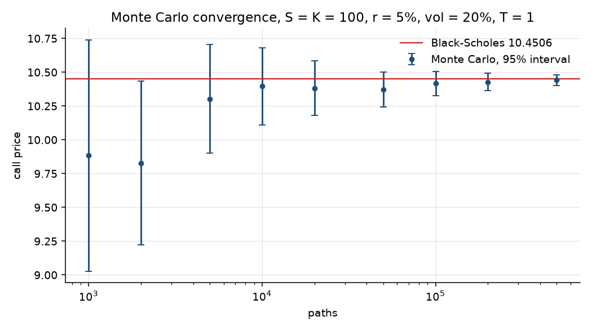
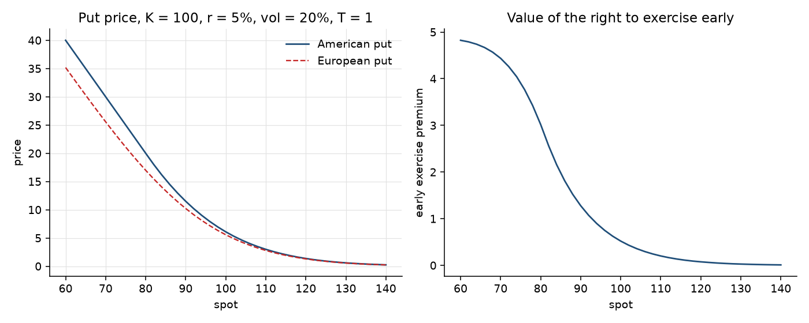
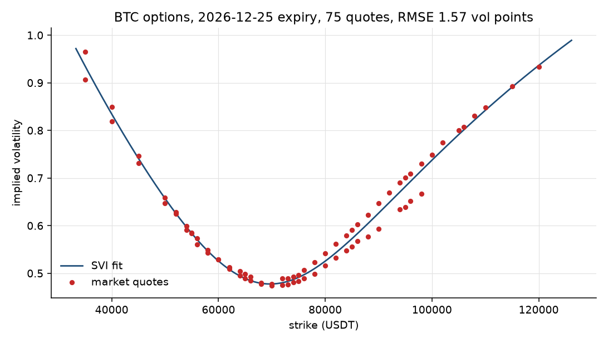
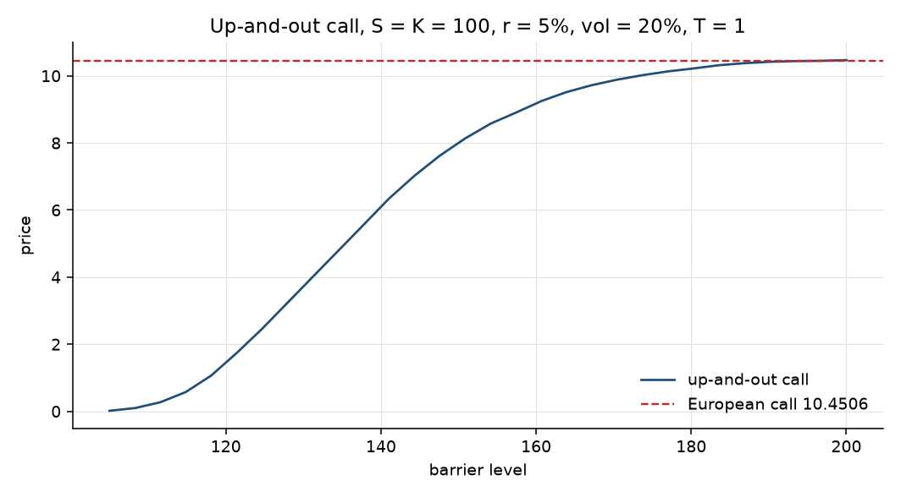
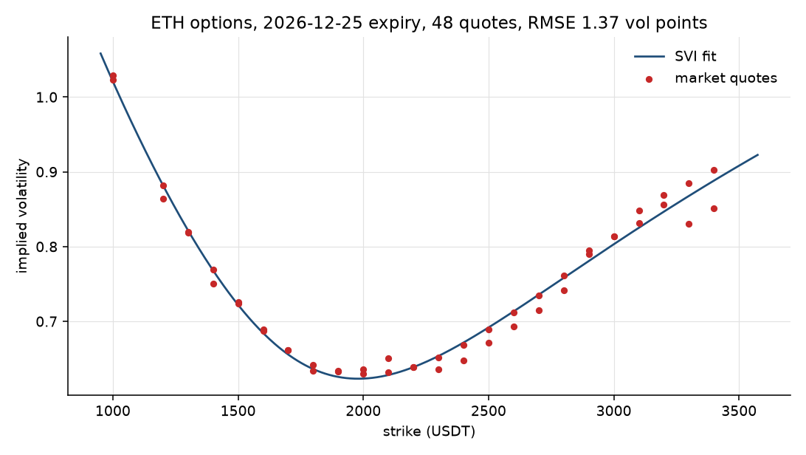
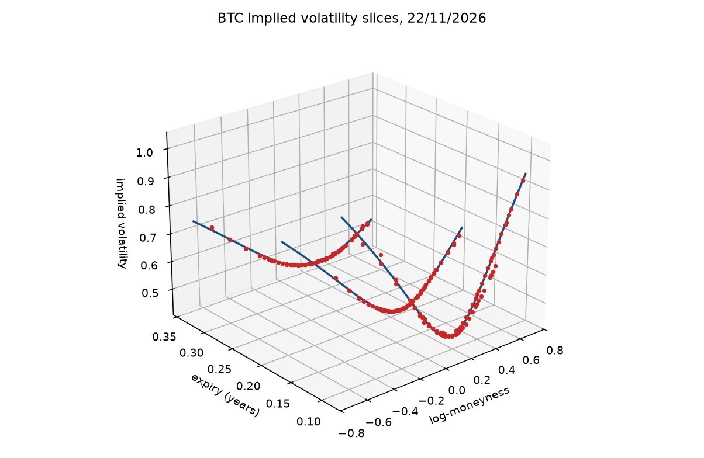

# options-pricer

[](https://github.com/IkerAbad/options-pricer/actions/workflows/ci.yml)
[](LICENSE)
[](https://pypi.org/project/options-pricer/)

API reference: **https://ikerabad.github.io/options-pricer/**

European, American and path-dependent option pricing in Python: closed-form
Black-Scholes, Monte Carlo with antithetic variates, implied volatility by root
finding, SVI calibration across a term structure, a binomial tree for early
exercise and path simulation for Asians and barriers. Every number in this
README comes from a command you can run.














## Results

Reference case: spot 100, strike 100, rate 5%, volatility 20%, expiry 1 year.

| Quantity | Value |
| --- | --- |
| Black-Scholes call | 10.450584 |
| Delta | 0.636831 |
| Gamma | 0.018762 |
| Vega | 37.524035 |
| Theta | -6.414028 |
| Rho | 53.232482 |
| Vanna | -0.281430 |
| Volga | 9.850059 |
| Charm | -0.065667 |
| Monte Carlo, 1,000,000 paths | 10.456536 |
| Standard error | 0.014737 |
| 95% interval | [10.427652, 10.485419] |

The analytic price falls inside the Monte Carlo interval. The standard error
falls with the square root of the number of paths, which is what the first plot
shows.

SVI calibration on a synthetic smile with 0.1 % relative price noise:

| Parameter | True | Fitted |
| --- | --- | --- |
| a | 0.02 | 0.022490 |
| b | 0.15 | 0.144749 |
| rho | -0.4 | -0.423434 |
| m | -0.05 | -0.051059 |
| sigma | 0.15 | 0.138244 |

RMSE in implied volatility: 0.021 vol points.

Four expiries, calibrated from short to long and chained through the previous
slice. The quotes come from a synthetic term structure with 0.1 % price noise.

| Expiry | a | b | rho | m | sigma | RMSE |
| --- | --- | --- | --- | --- | --- | --- |
| 0.25 | 0.0072 | 0.0867 | -0.326 | -0.020 | 0.136 | 0.001431 |
| 0.50 | 0.0145 | 0.0985 | -0.347 | -0.042 | 0.151 | 0.000682 |
| 1.00 | 0.0251 | 0.1205 | -0.368 | -0.071 | 0.184 | 0.000832 |
| 2.00 | 0.0651 | 0.0954 | -0.346 | -0.075 | 0.153 | 0.000278 |

`a` grows with maturity, which is the shape you expect when short-dated
volatility is higher than long-dated volatility.

## Options on a forward

Black-76 is the same model with the spot replaced by the forward. With
`F = 100 * exp(0.05) = 105.1271`, `K = 100`, `r = 5 %`, `vol = 20 %` and one
year:

| Quantity | Value |
| --- | --- |
| Call price | 10.450584 |
| Delta | 0.605772 |
| Gamma | 0.016977 |
| Vega | 37.524035 |

The price matches Black-Scholes when the forward is the theoretical one, which
is the consistency check in the tests.

## American options
Prices from a Cox-Ross-Rubinstein tree with 1,000 steps, same reference case:

| Option | American | European | Premium |
| --- | --- | --- | --- |
| Put | 6.089595 | 5.571527 | 0.518069 |
| Call, no dividend | 10.448584 | 10.448584 | 0.000000 |
| Call, 8% dividend yield | 6.541188 | 6.141112 | 0.400076 |

The put carries a real premium because waiting has a cost: the strike is
discounted and the downside is protected today. The call without dividends has
no premium, which is the standard no-arbitrage result. Adding a dividend yield
changes that, and the tree finds the value of the early exercise right.

## Real market data

`data/binance_btc_options_2026-11-22.csv` is a snapshot of the Binance BTC
options chain, captured on 2026-11-22 at 20:22 UTC with the index at 60,637.68
USDT. It holds 446 quotes across three expiries, calls and puts, filtered to
positive bid and ask, mid above 1 USDT, a relative spread below 50 % and
moneyness between 0.5 and 2.

The forward for each expiry comes from put-call parity on the pair closest to
the index, with a zero rate. SVI is fitted directly to the market implied
volatilities, which avoids the quote conversion that an inverse contract would
need.

| Expiry | Days | Forward | Quotes | RMSE |
| --- | --- | --- | --- | --- |
| 2026-12-25 | 32.5 | 60,875.00 | 75 | 1.57 vol points |
| 2027-01-29 | 67.5 | 61,127.50 | 85 | 0.42 vol points |
| 2027-03-26 | 123.5 | 61,627.50 | 78 | 0.58 vol points |

The short expiry is the hard one. A five-parameter SVI cannot follow the full
curvature of a 33-day crypto smile, and the fit leaves 1.57 vol points of RMSE.
That is visible in the last figure and it is reported, not hidden.

The snapshot is downloaded by `scripts/fetch_binance.py` and versioned so the
repository works without network access. `scripts/real_smile.py` rebuilds the
figure from the CSV.

The same pipeline runs on ETH, with 200 quotes and RMSE between 0.45 and 1.37
vol points. The two extra figures show the ETH smile and the three BTC slices in
three dimensions.

Calibration time on one real slice, ten repetitions:

| Constraint | Median | Minimum | Maximum |
| --- | --- | --- | --- |
| Soft penalty | 14.80 ms | 14.72 ms | 14.92 ms |
| Hard SLSQP | 16.44 ms | 16.33 ms | 16.80 ms |

Monte Carlo throughput with one million paths, median of five runs:

| Mode | Median | Paths per second |
| --- | --- | --- |
| Antithetic | 21.17 ms | 47,235,763 |
| Plain | 24.04 ms | 41,603,222 |

Black-Scholes throughput, 100,000 prices with strikes from 80 to 120:

| Time | Prices per second |
| --- | --- |
| 84.9 ms | 1,178,285 |

The closed form uses `math.erfc` instead of `scipy.stats.norm.cdf`. The change
multiplied throughput by a hundred and left every price bit-for-bit identical.

The vectorised path takes one million prices at once:

| Time | Prices per second |
| --- | --- |
| 30.2 ms | 33,087,603 |

Out-of-sample error and bootstrap intervals on the real BTC snapshot. The model
is fitted on two thirds of the strikes and scored on the rest:

| Expiry | Train RMSE | Test RMSE | `a` interval | `b` interval |
| --- | --- | --- | --- | --- |
| 2026-12-25 | 0.014913 | 0.017500 | [-0.0500, -0.0148] | [0.1324, 0.1999] |
| 2027-01-29 | 0.002176 | 0.002023 | [-0.0500, 0.0056] | [0.1253, 0.1969] |
| 2027-03-26 | 0.003454 | 0.003798 | [-0.0368, 0.0245] | [0.1431, 0.2084] |

The test error stays close to the train error, so the fit generalises to strikes
it never saw. The interval for `a` hits the lower bound on two slices, which is
the honest reading: five SVI parameters are not uniquely identified by a handful
of quotes, and `a` and `b` trade off against each other.

## Path-dependent options

Asian and barrier options are priced by Monte Carlo over full price paths. The
table uses 200,000 paths and 100 steps.

| Option | Price | Standard error |
| --- | --- | --- |
| Asian call, arithmetic average | 5.797045 | 0.017937 |
| Up-and-out call, barrier 120 | 1.424428 | 0.007951 |
| Up-and-out call, barrier 150 | 7.854730 | 0.024648 |
| Up-and-out call, barrier 200 | 10.363996 | 0.032452 |
| European call | 10.450584 | analytic |

The Asian is much cheaper than the European because averaging removes variance.
The barrier converges to the European price as the level moves away, which is
what the last figure shows.

Barriers are monitored at the simulation steps, not continuously. That
overprices knock-outs slightly, because a path can cross and come back between
two steps. The code does not pretend otherwise.

Delta, vega and theta for the barrier at 200 come from bump and reprice with
common random numbers: 0.623412, 33.576223 and -5.987842. Gamma is not reported
because the second difference is the same order as the Monte Carlo noise at
these path counts.

## No arbitrage

Two conditions are checked on every calibrated slice.

**Butterfly.** Gatheral's function

```
g(k) = (1 - k w' / (2 w))^2 - (w'^2 / 4) (1 / w + 1 / 4) + w'' / 2
```

must be non-negative at every log moneyness. A negative value means the implied
density is negative somewhere, which no arbitrage-free distribution can produce.

**Calendar.** Total variance must not decrease with maturity at a fixed log
moneyness: `w(k, T2) >= w(k, T1)` for `T2 > T1`.

On the real snapshot the three slices are butterfly-free: zero per cent of the
grid points violate `g >= 0`. Calendar is tighter. Fitting each expiry
independently leaves a gap of -0.0156 between the first two expiries, so the
short slice carries more total variance than the long one somewhere in the
wings. The long slice is then refitted with the calendar constraint imposed by
SLSQP instead of a penalty. The gap becomes +9.99e-15, zero to machine
precision, and the price is a worse fit: the RMSE of the middle expiry goes from
0.0021 to 0.0042, and the last one from 0.0035 to 0.0058.

The hard constraint is opt-in through `hard_calendar=True`. SLSQP can fail to
converge on a difficult slice, so the default remains the soft penalty.

That is a soft constraint, not a theorem. A hard guarantee needs an optimizer
with explicit non-linear constraints, and it is not implemented.

## What it does

- Black-Scholes prices and first and second order Greeks for European calls and
  puts.
- Vectorised Black-Scholes prices for arrays of spot and strike.
- Black-76 prices, forward Greeks and implied volatility for options on a
  forward.
- Monte Carlo under the exact lognormal terminal distribution, not an Euler
  discretisation, with antithetic variates, standard error and a 95 % interval.
- Implied volatility by Brent root finding, with an explicit rejection of prices
  outside the no-arbitrage range.
- SVI total-variance calibration by bounded least squares with a soft L1 loss.
- One slice per expiry, chained in time and regularised towards the previous
  slice, plus a 3D surface by interpolation in log time.
- American and European prices on the same binomial tree, with the early
  exercise premium measured directly.
- Asian and barrier options by Monte Carlo over simulated paths.
- Barrier delta, vega and theta by bump and reprice with common random numbers.
- SVI calibration on a versioned real snapshot of the Binance BTC options
  chain, not only on synthetic data.
- Butterfly and calendar diagnostics, plus a soft calendar penalty between
  consecutive expiries.
- Six figures that regenerate from a script.

## Install

```
pip install options-pricer
```

From the repository, with the development tools:

```
python -m venv .venv
.venv\Scripts\activate
pip install -e ".[dev]"
pytest
```

## Use

```
python -m options_pricer price --spot 100 --strike 100 --rate 0.05 --vol 0.2 --expiry 1
python -m options_pricer mc --spot 100 --strike 100 --rate 0.05 --vol 0.2 --expiry 1 --paths 1000000
python -m options_pricer iv --spot 100 --strike 100 --rate 0.05 --expiry 1 --price 10.45
python -m options_pricer american --spot 100 --strike 100 --rate 0.05 --vol 0.2 --expiry 1 --type put
python -m options_pricer asian --spot 100 --strike 100 --rate 0.05 --vol 0.2 --expiry 1 --type call
python -m options_pricer barrier --spot 100 --strike 100 --rate 0.05 --vol 0.2 --expiry 1 --barrier 120 --kind up-and-out
python -m options_pricer surface
python -m options_pricer surface --all
python -m options_pricer price --spot 100 --strike 100 --rate 0.05 --vol 0.2 --expiry 1 --json
python scripts/make_figures.py
python scripts/bench_calibration.py
python scripts/bench_monte_carlo.py
```

As a library:

```python
from options_pricer import binomial, call_price, greeks, implied_volatility, price_european
from options_pricer.surface import (
    SviParams,
    calibrate,
    calibrate_surface,
    example_term_structure,
    synthetic_surface,
)

value = call_price(100, 100, 0.05, 0.20, 1.0)
vol = implied_volatility(value, 100, 100, 0.05, 1.0, "call")
result = price_european("call", 100, 100, 0.05, 0.20, 1.0, paths=1_000_000)
american = binomial("put", 100, 100, 0.05, 0.20, 1.0, steps=1_000)

structure = example_term_structure()
expiries = list(structure)
quotes = synthetic_surface(
    100, 0.03, expiries, [90, 95, 100, 105, 110], [structure[t] for t in expiries]
)
rows = calibrate_surface(100, 0.03, expiries, [90, 95, 100, 105, 110], quotes)
```

## Conventions

- Prices and strikes are in currency units.
- Rates, volatilities and expiries are annualised. Expiry is in years.
- Rates are continuously compounded.
- Vega is the derivative with respect to volatility in units (0.20, not 20).
- Theta is the derivative with respect to time, per year.
- No dividends in the closed form. The binomial tree takes a continuous
  dividend yield.
- The SVI form is the raw parametrisation,
  `w(k) = a + b * (rho * (k - m) + sqrt((k - m)^2 + sigma^2))`, with
  `k = ln(K / F)` and `w = vol^2 * T`.

## Validation

108 tests cover:

- Reference prices 10.4506 and 5.5735 with tolerance 1e-3.
- Put-call parity to 1e-10.
- Greeks at the reference point and their signs.
- Vanna, volga and charm matching central finite differences of delta and vega,
  and agreeing between calls and puts.
- Monte Carlo interval containing the analytic price.
- Exact put-call parity per path using the sample mean terminal price.
- Error shrinking as the square root of the number of paths.
- Implied volatility recovering the input to 1e-6.
- Rejection of prices below intrinsic value and above the attainable range.
- SVI calibration recovering a noiseless surface to 1e-4 RMSE and surviving
  quoted noise.
- One stable fit per expiry across a term structure, with a downward slope in
  at-the-money volatility.
- American calls without dividends matching European calls.
- A positive early exercise premium for American puts and for calls with a
  dividend yield.
- Binomial European prices converging to Black-Scholes.
- Deep in-the-money American puts close to intrinsic value.
- Loading the versioned real snapshot, calibrating its three slices below three
  vol points and recovering the forward from put-call parity.
- Butterfly positivity on a regular slice, detection of a pathological one, and
  calendar gaps with the expected sign in both directions.
- Asian and barrier prices: a one-step Asian matching the European price, an
  Asian below the European, a far barrier matching the European, knock-in plus
  knock-out adding up to the European, and reproducibility from a seed.
- Property tests with Hypothesis: put-call parity, monotonicity in spot and
  strike, and Greek bounds over random valid inputs.
- Vectorised prices matching the scalar version element by element.
- Bootstrap intervals containing the point estimate and out-of-sample error
  below the in-sample error on a synthetic smile.

CI runs the suite and rebuilds the figures on Ubuntu and Windows, Python 3.12,
3.13 and 3.14.

## Documentation

- `docs/tutorial.md` for a complete pass over the package.
- `docs/math.md` for the formulas, the conventions and the no-arbitrage
  conditions.
- `https://ikerabad.github.io/options-pricer/` for the generated API reference.

## Development

```
pip install -e ".[dev]"
ruff check .
ruff format --check .
mypy src/options_pricer
pytest --cov=options_pricer --cov-report=term-missing
```

Line coverage is 94 % with branch coverage enabled. CI runs lint, format, types,
tests and coverage on Ubuntu and Windows with Python 3.12, 3.13 and 3.14.

## Limitations

- The American price comes from a binomial tree, not from the free boundary. The
  tree costs O(steps^2) and carries a discretisation error of a few cents at
  1,000 steps. The premium is the difference between two trees, so that error
  partially cancels.
- Exotic payoffs beyond Asians and barriers: no lookbacks, no cliquets, no
  Bermudan schedules.
- Barrier monitoring is discrete at the simulation steps. Continuous monitoring
  needs a Brownian bridge correction or a much finer time grid.
- No Greeks for path-dependent options.
- Black-Scholes assumes constant volatility and lognormal returns. The smile in
  the second figure exists because that assumption is false.
- The surface is an interpolation of the five SVI parameters in log time between
  calibrated expiries. It is not a continuous arbitrage-free model and it does
  not enforce calendar or butterfly constraints.
- SVI with five parameters is not uniquely identified by a handful of quotes.
  The chain and the ridge term stabilise it, and the fitted parameters are not
  meant to be read as ground truth.
- The hard calendar constraint uses SLSQP, which can fail to converge on a
  difficult slice. The fitted parameters are a local optimum, not a global one.
- The real data is a single snapshot of Binance BTC options. There is no time
  series, no second underlying and no execution costs.

## Español

Valoración de opciones europeas y americanas en Python: Black-Scholes cerrado,
Monte Carlo con variates antitéticas, volatilidad implícita por búsqueda de raíz,
calibración SVI encadenada a lo largo de la estructura temporal y árbol binomial
para el ejercicio anticipado.

Caso de referencia, con spot y strike 100, tipo 5 %, volatilidad 20 % y un año:
la call europea vale 10,450584. Con un millón de trayectorias, Monte Carlo da
10,456536 con un error estándar de 0,014737 y un intervalo al 95 % de 10,427652
a 10,485419.

En el árbol binomial con 1.000 pasos, la put americana vale 6,089595 frente a
5,571527 de la europea, con una prima de 0,518069. La call sin dividendos no
tiene prima, que es el resultado estándar de no arbitraje. Con un rendimiento por
dividendo del 8 %, la prima de la call sube a 0,400076.

La calibración SVI se hace por vencimientos encadenados, de corto a largo, con
una regularización suave hacia la slice anterior. Con cuatro vencimientos entre
0,25 y 2 años y un 0,1 % de ruido en precio, el RMSE queda por debajo de 0,0015
en todas las slices. La superficie de la tercera figura es una interpolación de
los cinco parámetros en tiempo logarítmico, no un modelo continuo libre de
arbitraje.

El repositorio incluye además un snapshot real de opciones de BTC de Binance,
capturado el 22/11/2026 con el índice en 60.637,68 USDT. Son 446 cotizaciones en
tres vencimientos. El forward de cada vencimiento sale de la paridad put-call con
tipo cero, y el SVI se ajusta directamente a las volatilidades implícitas del
mercado. El RMSE va de 0,21 puntos de volatilidad en el vencimiento a 67 días a
1,57 puntos en el de 33 días. El vencimiento corto es el difícil: un SVI de cinco
parámetros no sigue toda la curvatura de una sonrisa de cripto a un mes.

El ajuste se comprueba contra dos condiciones de no arbitraje. La de mariposa,
con la función de Gatheral, no se viola en ningún punto de las tres slices. La de
calendario sí: calibrando cada vencimiento por separado, la varianza total cae al
alargar el plazo en 0,0156. Al reajustar la slice larga con la restricción
impuesta por SLSQP, la violación desaparece, el gap queda en 9,99e-15, a cambio
de empeorar el RMSE del vencimiento intermedio de 0,0021 a 0,0042 y el del último
de 0,0035 a 0,0058. La restricción dura es opcional porque SLSQP puede no
converger en una slice difícil.

También hay opciones dependientes de la trayectoria. La asiática aritmética de
referencia vale 5,797045 con un error estándar de 0,017937, muy por debajo de la
europea porque promediar reduce la varianza. La up-and-out con barrera en 120
vale 1,424428, con barrera en 150 vale 7,854730 y con barrera en 200 se acerca a
la europea, 10,363996. La barrera se vigila en los pasos de simulación, no de
forma continua, y eso sobrevalora ligeramente las knock-out. Está escrito.

Las griegas de la barrera en 200 salen de recalcular el precio con perturbaciones
y números aleatorios comunes: delta 0,623412, vega 33,576223 y theta -5,987842.
No se publica gamma porque la segunda diferencia queda al nivel del ruido de
Monte Carlo con este número de caminos.

Los 108 tests cubren los precios de referencia, la paridad put-call, las griegas
de primer y segundo orden, la convergencia del error como 1/√N, la recuperación
de la volatilidad implícita, la calibración de una sonrisa, la estabilidad de la
estructura temporal, las propiedades del ejercicio anticipado, la calibración del
snapshot real, los diagnósticos de mariposa y calendario, y las relaciones entre
asiáticas, barreras y europeas. Vanna, volga y charm se comprueban contra
diferencias finitas centrales de delta y vega. La cobertura de línea es del 94 %
con cobertura de ramas, y el CI ejecuta ruff, mypy, los tests y la cobertura en
Ubuntu y Windows con Python 3.12, 3.13 y 3.14.

El mismo proceso se aplica a ETH, con 200 cotizaciones y un RMSE de entre 0,45 y
1,37 puntos de volatilidad. El benchmark de calibración de una slice real da
14,80 ms de mediana con la penalización suave y 16,44 ms con la restricción dura
de SLSQP.

La validación fuera de muestra usa dos tercios de los strikes para calibrar y el
resto para medir. En el snapshot de BTC, el RMSE de test va de 0,0020 a 0,0175,
siempre cerca del de entrenamiento. Los intervalos bootstrap de los parámetros
SVI se solapan entre sí y el de `a` toca la cota inferior en dos vencimientos.
Eso no es un fallo del código: cinco parámetros no quedan identificados por una
docena de cotizaciones, y `a` y `b` se compensan.

## License

MIT. See [LICENSE](LICENSE).
