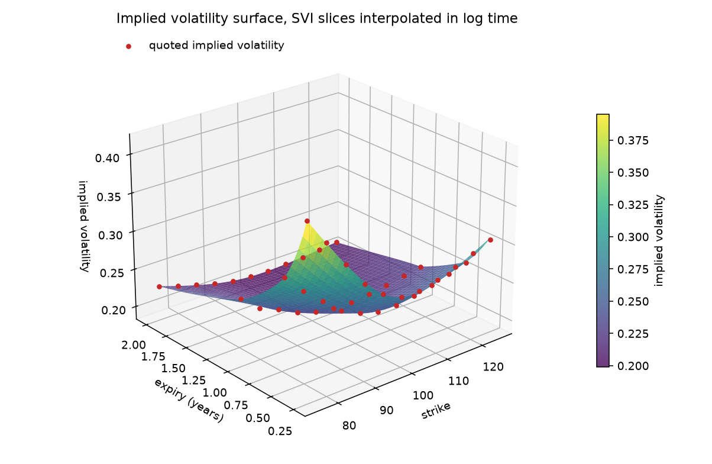

# options-pricer

[](https://github.com/IkerAbad/options-pricer/actions/workflows/ci.yml)
[](LICENSE)

European option pricing in Python: closed-form Black-Scholes, Monte Carlo with
antithetic variates, implied volatility by root finding and SVI calibration
across a term structure. Every number in this README comes from a command you
can run.




## Results

Reference case: spot 100, strike 100, rate 5%, volatility 20%, expiry 1 year.

| Quantity | Value |
| --- | --- |
| Black-Scholes call | 10.450584 |
| Delta | 0.636831 |
| Gamma | 0.018762 |
| Vega | 37.524035 |
| Theta | -6.414028 |
| Rho | 53.232482 |
| Monte Carlo, 1,000,000 paths | 10.456536 |
| Standard error | 0.014737 |
| 95% interval | [10.427652, 10.485419] |

The analytic price falls inside the Monte Carlo interval. The standard error
falls with the square root of the number of paths, which is what the first plot
shows.

SVI calibration on a synthetic smile with 0.1 % relative price noise:

| Parameter | True | Fitted |
| --- | --- | --- |
| a | 0.02 | 0.022490 |
| b | 0.15 | 0.144749 |
| rho | -0.4 | -0.423434 |
| m | -0.05 | -0.051059 |
| sigma | 0.15 | 0.138244 |

RMSE in implied volatility: 0.021 vol points.

Four expiries, calibrated from short to long and chained through the previous
slice. The quotes come from a synthetic term structure with 0.1 % price noise.

| Expiry | a | b | rho | m | sigma | RMSE |
| --- | --- | --- | --- | --- | --- | --- |
| 0.25 | 0.0072 | 0.0867 | -0.326 | -0.020 | 0.136 | 0.001431 |
| 0.50 | 0.0145 | 0.0985 | -0.347 | -0.042 | 0.151 | 0.000682 |
| 1.00 | 0.0251 | 0.1205 | -0.368 | -0.071 | 0.184 | 0.000832 |
| 2.00 | 0.0651 | 0.0954 | -0.346 | -0.075 | 0.153 | 0.000278 |

`a` grows with maturity, which is the shape you expect when short-dated
volatility is higher than long-dated volatility.

## What it does

- Black-Scholes prices and first-order Greeks for European calls and puts.
- Monte Carlo under the exact lognormal terminal distribution, not an Euler
  discretisation, with antithetic variates, standard error and a 95 % interval.
- Implied volatility by Brent root finding, with an explicit rejection of prices
  outside the no-arbitrage range.
- SVI total-variance calibration by bounded least squares with a soft L1 loss.
- One slice per expiry, chained in time and regularised towards the previous
  slice, plus a 3D surface by interpolation in log time.
- Three figures that regenerate from a script.

## Install

```
python -m venv .venv
.venv\Scripts\activate
pip install -e ".[dev]"
pytest
```

## Use

```
python -m options_pricer price --spot 100 --strike 100 --rate 0.05 --vol 0.2 --expiry 1
python -m options_pricer mc --spot 100 --strike 100 --rate 0.05 --vol 0.2 --expiry 1 --paths 1000000
python -m options_pricer iv --spot 100 --strike 100 --rate 0.05 --expiry 1 --price 10.45
python -m options_pricer surface
python -m options_pricer surface --all
python scripts/make_figures.py
```

As a library:

```python
from options_pricer import call_price, greeks, implied_volatility, price_european
from options_pricer.surface import (
    SviParams,
    calibrate,
    calibrate_surface,
    example_term_structure,
    synthetic_surface,
)

value = call_price(100, 100, 0.05, 0.20, 1.0)
vol = implied_volatility(value, 100, 100, 0.05, 1.0, "call")
result = price_european("call", 100, 100, 0.05, 0.20, 1.0, paths=1_000_000)

structure = example_term_structure()
expiries = list(structure)
quotes = synthetic_surface(100, 0.03, expiries, [90, 95, 100, 105, 110],
                           [structure[t] for t in expiries])
rows = calibrate_surface(100, 0.03, expiries, [90, 95, 100, 105, 110], quotes)
```

## Conventions

- Prices and strikes are in currency units.
- Rates, volatilities and expiries are annualised. Expiry is in years.
- Rates are continuously compounded.
- Vega is the derivative with respect to volatility in units (0.20, not 20).
- Theta is the derivative with respect to time, per year.
- No dividends. A continuous dividend yield can be added by shifting the rate,
  and it is not implemented.
- The SVI form is the raw parametrisation,
  `w(k) = a + b * (rho * (k - m) + sqrt((k - m)^2 + sigma^2))`, with
  `k = ln(K / F)` and `w = vol^2 * T`.

## Validation

30 tests cover:

- Reference prices 10.4506 and 5.5735 with tolerance 1e-3.
- Put-call parity to 1e-10.
- Greeks at the reference point and their signs.
- Monte Carlo interval containing the analytic price.
- Exact put-call parity per path using the sample mean terminal price.
- Error shrinking as the square root of the number of paths.
- Implied volatility recovering the input to 1e-6.
- Rejection of prices below intrinsic value and above the attainable range.
- SVI calibration recovering a noiseless surface to 1e-4 RMSE and surviving
  quoted noise.
- One stable fit per expiry across a term structure, with a downward slope in
  at-the-money volatility.
- Reproducibility of the synthetic surface from a seed.

CI runs the suite and rebuilds the figures on Ubuntu and Windows, Python 3.12
and 3.13.

## Limitations

- European options only. No early exercise, no American or Bermudan payoffs.
- Black-Scholes assumes constant volatility and lognormal returns. The smile in
  the second figure exists because that assumption is false.
- The surface is an interpolation of the five SVI parameters in log time between
  calibrated expiries. It is not a continuous arbitrage-free model and it does
  not enforce calendar or butterfly constraints.
- SVI with five parameters is not uniquely identified by a handful of quotes.
  The chain and the ridge term stabilise it, and the fitted parameters are not
  meant to be read as ground truth.
- The market is synthetic. The repo does not download quotes, so it cannot be
  validated against a real chain without adding a data source.
- First-order Greeks only. No vanna, volga or charm.

## Español

Valoración de opciones europeas en Python: Black-Scholes cerrado, Monte Carlo con
variates antitéticas, volatilidad implícita por búsqueda de raíz y calibración
SVI por mínimos cuadrados con cotas, encadenada a lo largo de la estructura
temporal.

Caso de referencia, con spot y strike 100, tipo 5 %, volatilidad 20 % y un año:
la call vale 10,450584. Con un millón de trayectorias, Monte Carlo da 10,456536
con un error estándar de 0,014737 y un intervalo al 95 % de 10,427652 a
10,485419.

La calibración se hace por vencimientos encadenados, de corto a largo, con una
regularización suave hacia la slice anterior. Con cuatro vencimientos entre 0,25
y 2 años y un 0,1 % de ruido en precio, el RMSE queda por debajo de 0,0015 en
todas las slices. La superficie de la tercera figura es una interpolación de los
cinco parámetros en tiempo logarítmico, no un modelo continuo libre de arbitraje.

Los 30 tests cubren los precios de referencia, la paridad put-call, las griegas,
la convergencia del error como 1/√N, la recuperación de la volatilidad implícita,
la calibración de una sonrisa y la estabilidad de la estructura temporal.

## License

MIT. See [LICENSE](LICENSE).
